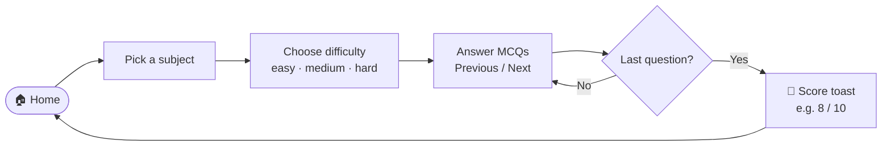

<div align="center">

# 🎯 CrackInt

**Crack your technical interviews — practise 185 MCQs across 10 core CS subjects, filtered by difficulty, with instant scoring.**

[](https://crackint.vercel.app)


[Subjects](#-subjects) · [How it works](#-how-it-works) · [Getting Started](#-getting-started) · [Add questions](#-adding-your-own-questions) · [Structure](#-project-structure)

</div>

---

## 📚 Subjects

| Subject | Focus |
|---|---|
| 🧱 Data Structures | Arrays, Trees and Graphs |
| ⚙️ Algorithms | Sorting, Searching and Optimization |
| 🖥️ Operating Systems | Processes, Threads and Memory Management |
| 🗄️ Database Management | SQL and Data Modeling |
| 🌐 Computer Networks | Networking Protocols and Architectures |
| 🧩 Object-Oriented Programming | Classes, Objects and Design Principles |
| 🏗️ Software Engineering | SDLC and Agile Methodologies |
| 💻 Web Development | Building Interactive Websites and Apps |
| 🤖 Machine Learning | AI and Predictive Analytics |
| 🧮 Aptitude | Logical and Quantitative Skills |

**Question bank:** 185 questions across the 10 subjects (~19 per subject), most tagged by difficulty — `63 easy` · `53 medium` · `11 hard`.

## 🔄 How it works



## ✨ Features

- 🗂️ **Subject sidebar** to jump between topics
- 🎚️ **Difficulty filter** — practise only what you need
- ✅ **Instant feedback** on each answer and a final score
- 🔁 **Navigate freely** with Previous / Next
- 🔔 **Toast notifications** via `react-toastify`
- 🌑 **Dark, responsive UI** built with Tailwind CSS v4

## 🚀 Getting Started

```bash
git clone https://github.com/Shariq2003/CrackInt.git
cd CrackInt
npm install
npm run dev          # http://localhost:5173
```

<details>
<summary><b>📜 Available scripts</b></summary>

| Command | What it does |
|---|---|
| `npm run dev` | Start the dev server |
| `npm run build` | Production build |
| `npm run preview` | Preview the build |
| `npm run lint` | Run ESLint |

</details>

## ➕ Adding your own questions

All content lives in **[`src/data.js`](src/data.js)**. Add an object to the `PROBLEMS` array:

<details>
<summary><b>Show question format</b></summary>

```js
{
  key: 1,                      // subject key (1 = Data Structures, 2 = Algorithms, …)
  level: "easy",               // "easy" | "medium" | "hard"
  question: "Which data structure uses LIFO?",
  options: [
    { option: "Queue", is_answer: false },
    { option: "Stack", is_answer: true },
    { option: "Heap",  is_answer: false },
    { option: "Graph", is_answer: false },
  ],
}
```

</details>

## 📁 Project Structure

<details>
<summary><b>Expand tree</b></summary>

```text
src/
├── components/   # Sidebar, Card, Quiz, QuizCard
├── pages/        # Home, QuizPage
├── data.js       # SUBJECTS + PROBLEMS question bank
├── App.jsx       # routes: /, /home, /quizPage
└── main.jsx
```

</details>

## 📜 License

[MIT](LICENSE)

---

<div align="center">

Built by **[Shariq](https://github.com/Shariq2003)** · [LinkedIn](https://www.linkedin.com/in/shariq-sd)

⭐ Good luck with your interviews — and consider giving this repo a star!

</div>
